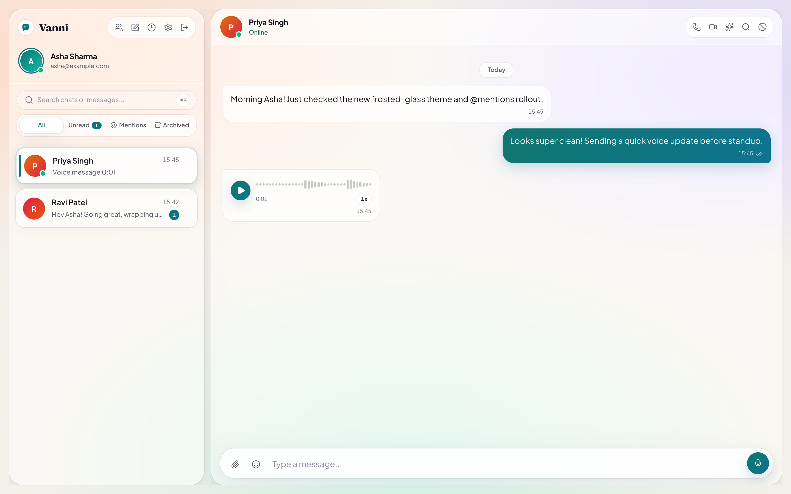
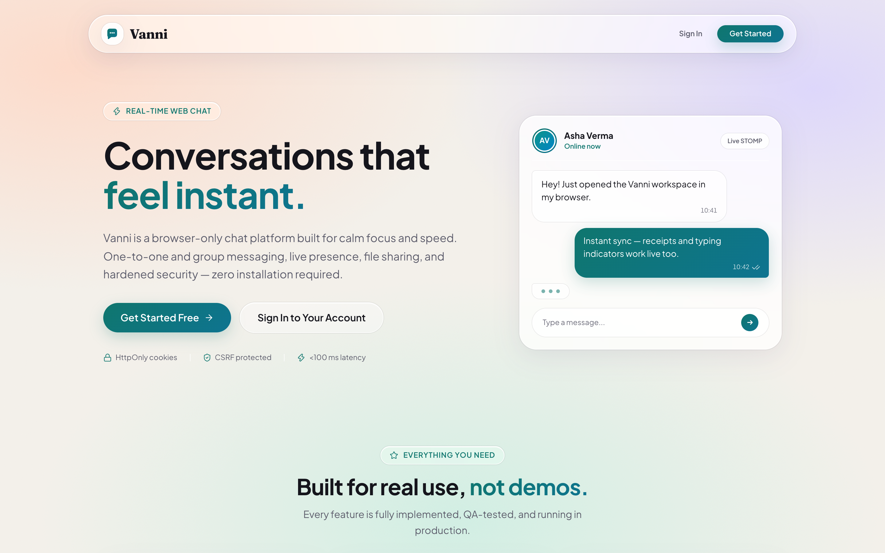
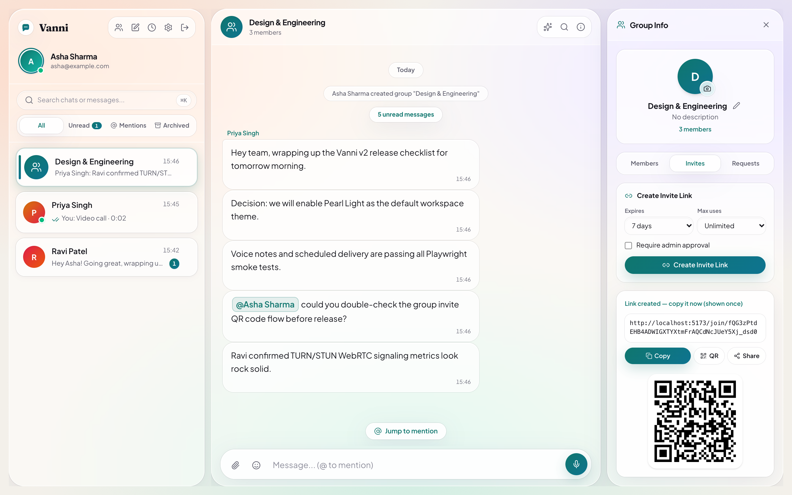
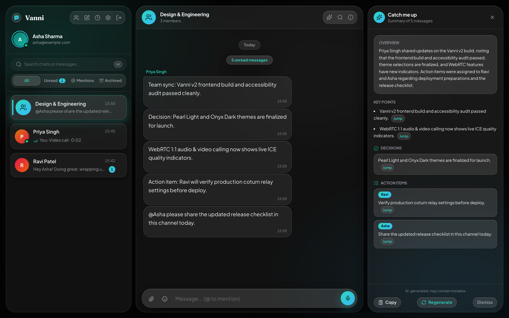
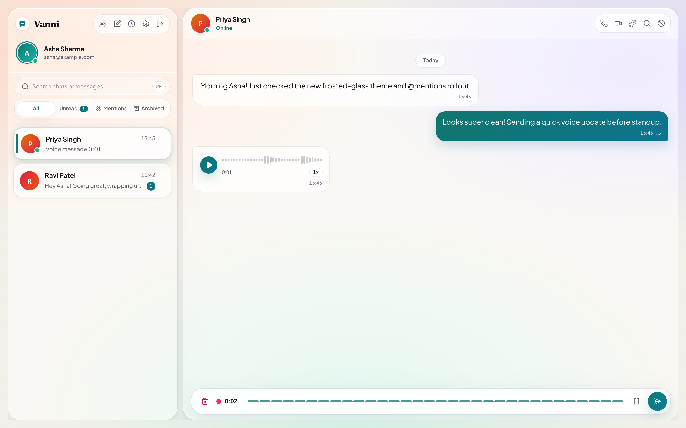
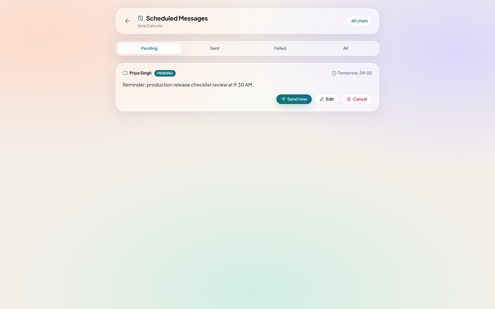
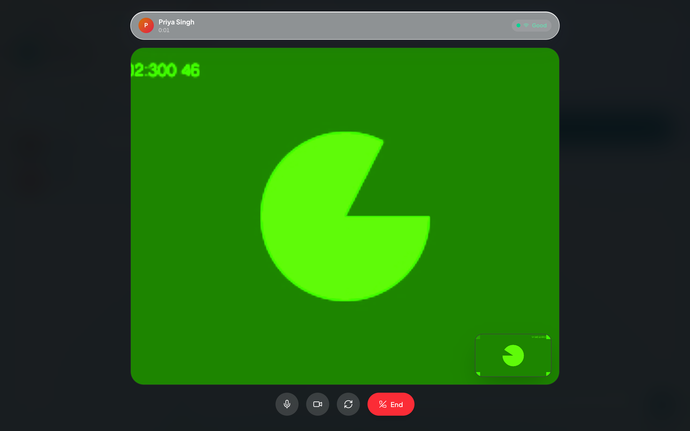
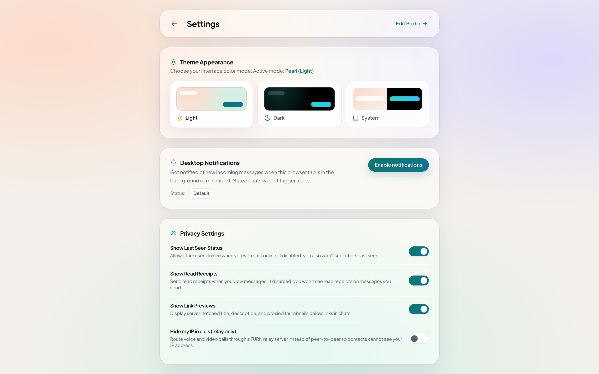
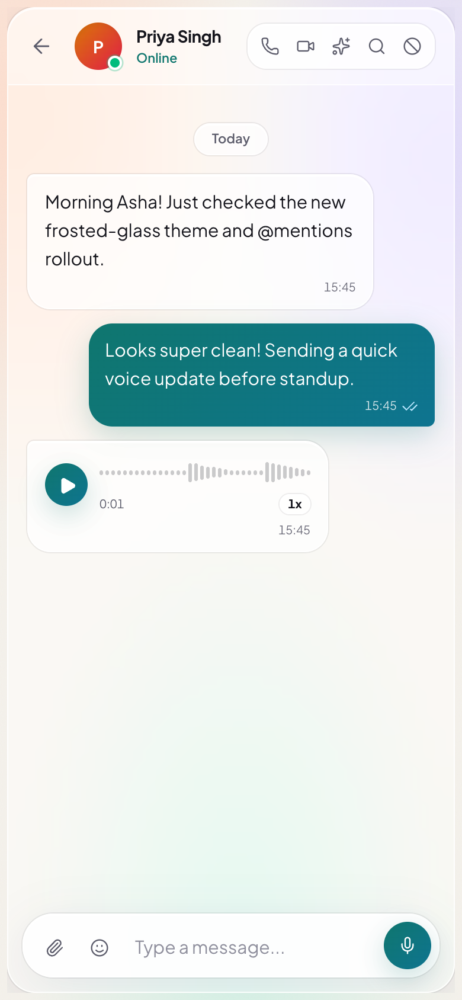

<div align="center">

# Vanni

**A real-time web chat platform crafted with frosted-glass aesthetics, hardened security, AI conversation recaps, and sub-second STOMP messaging & WebRTC calls.**

[](backend/pom.xml)
[](backend/pom.xml)
[](frontend/package.json)
[](frontend/package.json)
[](docker-compose.yml)

<br />



</div>

---

## Overview

**Vanni** runs directly in any modern desktop or mobile browser with zero installation. Users can register, search contacts, chat one-to-one or in groups with `@mentions`, share voice notes, files, and rich link previews, schedule future messages, join groups via invite links or QR codes, catch up on missed conversations with server-side AI summaries, and hop onto 1:1 WebRTC voice or video calls.

Built around the **Vanni Glass** design system, the interface pairs **Pearl** (warm cream mesh light mode) and **Onyx** (true-black dark mode) with translucent frosted panels, crisp teal-sky accents, and a **Fraunces** wordmark.

---

## UI Showcase (Pearl Light & Onyx Dark)

<table>
  <tr>
    <th width="50%">Landing Page (Pearl Light)</th>
    <th width="50%">Sign In (Pearl Light)</th>
  </tr>
  <tr>
    <td></td>
    <td></td>
  </tr>
  <tr>
    <th>Group @Mentions, Invite Links & QR (Pearl Light)</th>
    <th>AI "Catch me up" Recap — Onyx Dark</th>
  </tr>
  <tr>
    <td></td>
    <td></td>
  </tr>
  <tr>
    <th>Voice Message Recording & Waveforms (Pearl Light)</th>
    <th>Scheduled Messages Queue (Pearl Light)</th>
  </tr>
  <tr>
    <td></td>
    <td></td>
  </tr>
  <tr>
    <th>1:1 WebRTC Video Call</th>
    <th>Settings, Privacy & Call Relay (Pearl Light)</th>
  </tr>
  <tr>
    <td></td>
    <td></td>
  </tr>
</table>

<div align="center">
  <strong>Mobile View (390px — Pearl Light)</strong><br /><br />
  
</div>

---

## Key Capabilities

| Area | Highlights |
|---|---|
| **Authentication & Security** | HttpOnly JWT cookie (`vanni_at`), SHA-256 hashed rotating refresh tokens (`vanni_rt`) with reuse-family revocation, SPA CSRF (`X-XSRF-TOKEN`), strict WebSocket `Origin` validation, Bucket4j rate limiting with `Retry-After`, CSP/HSTS/Permissions-Policy headers, and `X-Request-Id` MDC logging. |
| **Real-Time Messaging & Groups** | STOMP over WebSocket (`/ws`), idempotent `clientMessageId` delivery, cursor pagination, live typing & presence, `@mentions` with `@all` admin rate-limits and `@` badge filtering, plus SHA-256 hashed invite links with expiration, usage caps, admin approval, and QR codes. |
| **Voice, Previews & Scheduling** | Browser `MediaRecorder` voice notes with 64-bar waveform playback and HTTP `Range` streaming; SSRF-hardened OpenGraph link previews via `SafeHttpFetcher` and local image proxying; UTC-stored scheduled messages claimed once via `FOR UPDATE SKIP LOCKED`. |
| **AI "Catch me up" & Calls** | Per-user opt-in unread conversation summaries powered server-side by Gemini (`gemini-flash-lite-latest`) or Anthropic with prompt-injection boundaries and zero stored transcripts; 1:1 WebRTC audio/video calls over STOMP signaling with ICE quality indicators and relay-only privacy mode. |
| **Receipts, Media & Themes** | Monotonic `SENT` → `DELIVERED` → `READ` receipts, Apache Tika MIME sniffing, EXIF stripping, pluggable attachment storage (`local`, `cloudinary`, `s3`), Pearl (`Light`) / Onyx (`Dark`) / System themes, and 390px mobile responsiveness. |

---

## Architecture

```text
  Browser (React 19 + STOMP.js + WebRTC)
       │  HTTPS / WSS (HttpOnly cookies + X-XSRF-TOKEN)
       ▼
  Nginx Reverse Proxy / Vite Dev Proxy
       ├── /api/**  ──▶ Spring Boot REST Controllers ──▶ Services / Bucket4j ──▶ MySQL 8.4 (Flyway V1..V14)
       │                                              ├── SafeHttpFetcher (SSRF-guarded previews)
       │                                              ├── AI Provider (Gemini / Anthropic, server-side)
       │                                              └── Storage (Local / S3 / Cloudinary)
       ├── /ws      ──▶ STOMP Handshake + Auth Interceptor ──▶ EventPublisher + Call Signaling
       └── /*       ──▶ React SPA (dist/)
```

---

## Tech Stack

| Layer | Technologies |
|---|---|
| **Frontend** | React 19, Vite 8, Tailwind CSS 4, TanStack Query 5, React Hook Form, Zod, `@stomp/stompjs`, Lucide, `qrcode.react`, Plus Jakarta Sans & Fraunces |
| **Backend** | Java 21 LTS, Spring Boot 4.1.3, Spring Security, Spring Data JPA, Spring WebSocket (STOMP), Flyway, JJWT, Bucket4j, Apache Tika, Jsoup, Apache HttpClient 5, Caffeine |
| **Database** | MySQL 8.4 (`utf8mb4`) |
| **Testing & QA** | JUnit 5, Mockito, MockMvc, Testcontainers (MySQL), JaCoCo, Vitest, React Testing Library, MSW, Playwright |
| **Deployment** | Multi-stage Docker builds, Nginx reverse proxy, GitHub Actions CI/CD |

---

## Getting Started

### Prerequisites

- **Java 21 LTS** (`/opt/homebrew/opt/openjdk@21` on macOS)
- **Node.js 22+** and **npm**
- **Docker Desktop** (`docker compose`)

### Local Development

```bash
# 1. Copy environment template (and optionally set GEMINI_API_KEY)
cp .env.example .env

# 2. Start MySQL 8.4 on host port 3307
docker compose up -d mysql

# 3. Start Spring Boot backend (port 8080, dev profile seeds demo accounts & enables AI summaries)
cd backend && set -a && . ../.env && set +a && SPRING_PROFILES_ACTIVE=dev ./mvnw spring-boot:run

# 4. Start React frontend (port 5173, proxies /api and /ws -> :8080)
cd frontend && npm install && npm run dev -- --port 5173
```

Open [http://localhost:5173](http://localhost:5173). *(Avoid ports `5000` and `7000` on macOS, which are reserved by AirPlay Receiver.)*

### Self-Hosted Production (Docker Compose)

```bash
cp .env.example .env
# Configure DB_ROOT_PASSWORD, DB_PASSWORD, JWT_SECRET (64+ chars), ALLOWED_ORIGINS, and optional AI / TURN secrets
docker compose -f docker-compose.prod.yml up -d --build
```

Nginx exposes the app on `${APP_PORT:-8088}` and proxies `/api` and `/ws` internally to the non-root `backend:8080` service.

---

## Environment Variables

See [`.env.example`](.env.example) for the complete reference:

| Variable | Default (dev) | Purpose |
|---|---|---|
| `SERVER_PORT` | `8080` | Backend HTTP port |
| `DB_HOST` / `DB_PORT` / `DB_NAME` | `localhost` / `3307` / `vanni` | MySQL 8.4 connection |
| `DB_USER` / `DB_PASSWORD` | `vanni` / `vannipass` | Database credentials |
| `JWT_SECRET` | dev fallback | 64+ character HMAC secret (required in production) |
| `COOKIE_SECURE` | `false` (`true` in `prod`) | `Secure` flag on `vanni_at` and `vanni_rt` cookies |
| `ALLOWED_ORIGINS` | `http://localhost:5173` | Allowed WebSocket `Origin` patterns |
| `STORAGE_PROVIDER` / `STORAGE_LOCAL_DIR` | `local` / `./uploads` | Attachment, voice & avatar storage (`local` \| `cloudinary` \| `s3`) |
| `MAX_UPLOAD_MB` | `10` | Maximum attachment upload size |
| `AI_FEATURES_ENABLED` / `AI_PROVIDER` | `true` (`dev`) / `auto` (`dev`) | Server-side Catch me up toggle & provider (`gemini` \| `anthropic` \| `fake` \| `auto`) |
| `GEMINI_API_KEY` / `GEMINI_MODEL` | unset / `gemini-flash-lite-latest` | Gemini API key (server-side only) and model alias |
| `CALLS_STUN_URLS` / `CALLS_TURN_URLS` | Google STUN / unset | WebRTC ICE servers and optional TURN credentials |
| `APP_PORT` | `8088` | Host port mapped to Nginx in `docker-compose.prod.yml` |

---

## Testing & Quality

```bash
# Backend unit, integration (Testcontainers MySQL), security & WebSocket tests + JaCoCo
cd backend && ./mvnw -q verify

# Frontend lint, unit/MSW tests, production build & Playwright E2E
cd frontend && npm run lint && npm test -- --run && npm run build && npx playwright test
```
