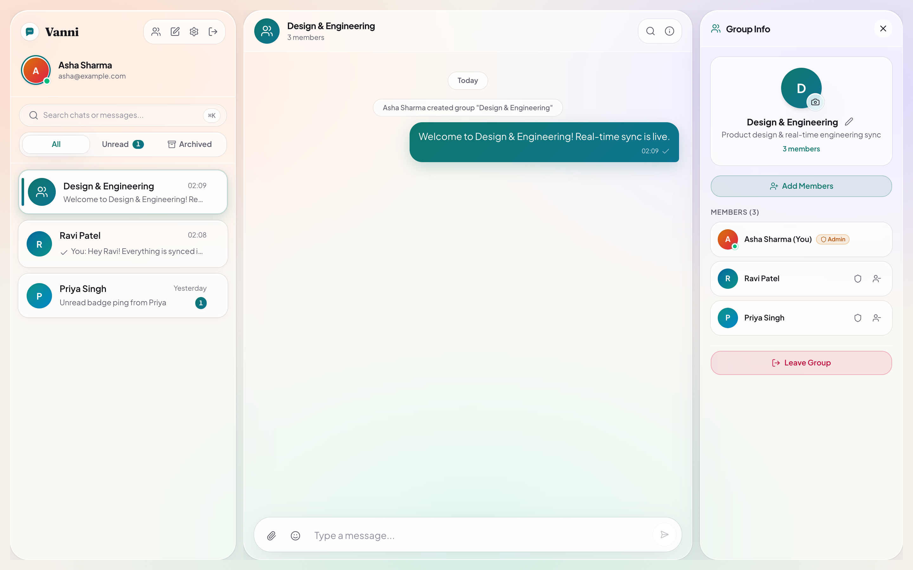
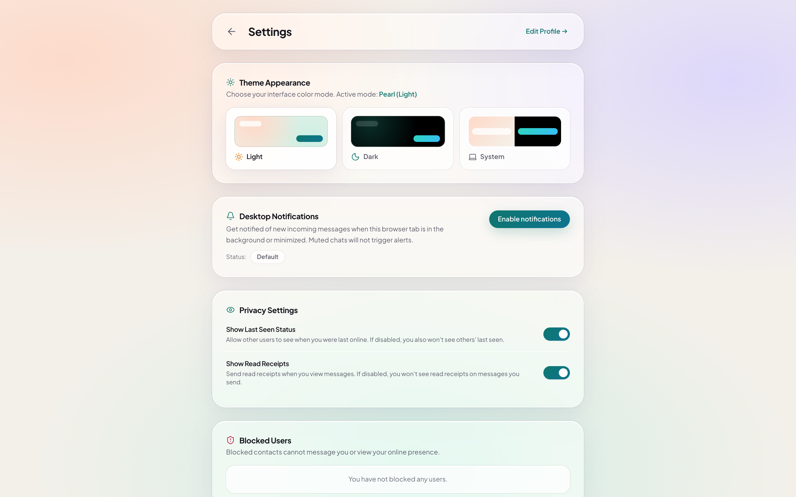
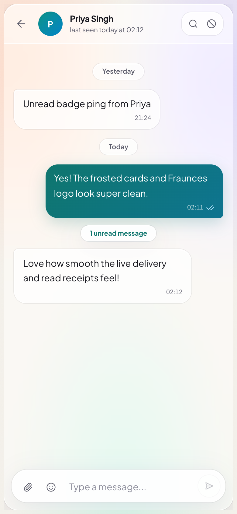

<div align="center">

# Vanni

**A real-time web chat platform crafted with frosted-glass aesthetics, hardened security, and sub-second STOMP messaging.**

[](backend/pom.xml)
[](backend/pom.xml)
[](frontend/package.json)
[](frontend/package.json)
[](docker-compose.yml)

<br />


</div>

---

## Overview

**Vanni** runs directly in any modern desktop or mobile browser with zero installation. Users can register, search contacts, chat one-to-one or in groups, share images and documents, react, reply, edit, or delete messages, and see live presence, typing indicators, and delivery/read receipts in real time.

Built around the **Vanni Glass** design system, the interface pairs **Pearl** (warm cream mesh light mode) and **Onyx** (true-black dark mode) with translucent frosted panels, crisp teal-sky accents, and a bespoke **Fraunces** wordmark.

---

## UI Showcase (Pearl Light & Onyx Dark)

<table>
  <tr>
    <th width="50%">Landing Page (Pearl Light)</th>
    <th width="50%">Sign In (Pearl Light)</th>
  </tr>
  <tr>
    <td></td>
    <td></td>
  </tr>
  <tr>
    <th>Group Workspace & Info Panel (Pearl Light)</th>
    <th>Profile (Pearl Light)</th>
  </tr>
  <tr>
    <td></td>
    <td></td>
  </tr>
  <tr>
    <th>Settings & Theme Switcher (Pearl Light)</th>
    <th>Active Chat — Onyx Dark Mode</th>
  </tr>
  <tr>
    <td></td>
    <td></td>
  </tr>
</table>

<div align="center">
  <strong>Mobile View (390px — Pearl Light)</strong><br /><br />
  
</div>

---

## Key Capabilities

| Area | Highlights |
|---|---|
| **Authentication & Security** | HttpOnly JWT cookie (`vanni_at`), SHA-256 hashed rotating refresh tokens (`vanni_rt`) with reuse-family revocation, SPA CSRF (`X-XSRF-TOKEN`), strict WebSocket `Origin` validation, Bucket4j rate limiting with `Retry-After`, CSP/HSTS headers, and `X-Request-Id` MDC logging. |
| **Real-Time Messaging** | STOMP over WebSocket (`/ws`), idempotent `clientMessageId` delivery, cursor pagination (`before`/`after`), server-throttled typing indicators, group admin roles, member management, and live system events. |
| **Receipts & Notifications** | Monotonic `SENT` → `DELIVERED` → `READ` state machine, per-recipient receipt inspection, unread badge counters, privacy toggles (`showLastSeen`, `showReadReceipts`), pin/mute/archive controls, and browser notifications. |
| **Attachments & Profiles** | Apache Tika MIME sniffing, spoofed/executable file rejection, image EXIF stripping, pluggable storage (`local`, `cloudinary`, `s3`), user & group avatars, and multi-image lightbox navigation. |
| **Rich Chat UX & Themes** | Quoted replies, emoji reactions, 15-minute edit window, soft delete, in-chat & global message search, user blocking, Light (`Pearl`) / Dark (`Onyx`) / System themes, and multi-device logout. |

---

## Architecture

```text
  Browser (React 19 + STOMP.js)
       │  HTTPS / WSS (HttpOnly cookies + X-XSRF-TOKEN)
       ▼
  Nginx Reverse Proxy / Vite Dev Proxy
       ├── /api/**  ──▶ Spring Boot REST Controllers ──▶ Services / Bucket4j ──▶ MySQL 8.4 (Flyway V1..V6)
       ├── /ws      ──▶ STOMP Handshake + Auth Interceptor ──▶ EventPublisher ──▶ Storage (Local / S3 / Cloudinary)
       └── /*       ──▶ React SPA (dist/)
```

---

## Tech Stack

| Layer | Technologies |
|---|---|
| **Frontend** | React 19, Vite 8, Tailwind CSS 4, TanStack Query 5, React Hook Form, Zod, `@stomp/stompjs`, Lucide, Plus Jakarta Sans & Fraunces |
| **Backend** | Java 21 LTS, Spring Boot 4.1.3, Spring Security, Spring Data JPA, Spring WebSocket (STOMP), Flyway, JJWT, Bucket4j, Apache Tika |
| **Database** | MySQL 8.4 (`utf8mb4`) |
| **Testing & QA** | JUnit 5, Mockito, MockMvc, JaCoCo, Vitest, React Testing Library, MSW, Playwright, Lighthouse |
| **Deployment** | Multi-stage Docker builds, Nginx reverse proxy, GitHub Actions CI/CD |

---

## Getting Started

### Prerequisites

- **Java 21 LTS** (`/opt/homebrew/opt/openjdk@21` on macOS)
- **Node.js 22+** and **npm**
- **Docker Desktop** (`docker compose`)

### Local Development

```bash
# 1. Copy environment template
cp .env.example .env

# 2. Start MySQL 8.4 on host port 3307
docker compose up -d mysql

# 3. Start Spring Boot backend (port 8080, dev profile seeds demo accounts)
cd backend && SPRING_PROFILES_ACTIVE=dev ./mvnw spring-boot:run

# 4. Start React frontend (port 5173, proxies /api and /ws -> :8080)
cd frontend && npm install && npm run dev
```

Open [http://localhost:5173](http://localhost:5173). *(Avoid ports `5000` and `7000` on macOS, which are reserved by AirPlay Receiver.)*

### Self-Hosted Production (Docker Compose)

```bash
cp .env.example .env
# Configure DB_ROOT_PASSWORD, DB_PASSWORD, JWT_SECRET (64+ chars), and ALLOWED_ORIGINS
docker compose -f docker-compose.prod.yml up -d --build
```

Nginx exposes the app on `${APP_PORT:-8088}` and proxies `/api` and `/ws` internally to the non-root `backend:8080` service.

---

## Environment Variables

See [`.env.example`](.env.example) for the complete reference:

| Variable | Default (dev) | Purpose |
|---|---|---|
| `SERVER_PORT` | `8080` | Backend HTTP port |
| `DB_HOST` / `DB_PORT` / `DB_NAME` | `localhost` / `3307` / `vanni` | MySQL 8.4 connection |
| `DB_USER` / `DB_PASSWORD` | `vanni` / `vannipass` | Database credentials |
| `JWT_SECRET` | dev fallback | 64+ character HMAC secret (required in production) |
| `COOKIE_SECURE` | `false` (`true` in `prod`) | `Secure` flag on `vanni_at` and `vanni_rt` cookies |
| `ALLOWED_ORIGINS` | `http://localhost:5173,...` | Allowed WebSocket `Origin` patterns |
| `STORAGE_PROVIDER` / `STORAGE_LOCAL_DIR` | `local` / `./uploads` | Attachment & avatar storage (`local` \| `cloudinary` \| `s3`) |
| `MAX_UPLOAD_MB` | `10` | Maximum attachment upload size |
| `APP_PORT` | `8088` | Host port mapped to Nginx in `docker-compose.prod.yml` |

---

## API & WebSocket Summary

- **REST (`/api`):** Auth (`/auth/register`, `/auth/login`, `/auth/refresh`, `/auth/logout`, `/auth/logout-all`, `/auth/change-password`, `/auth/csrf`), Users (`/users/me`, `/users/me/avatar`, `/users/{id}/block`, `/users/blocked`), Conversations (`/conversations`, `/direct`, `/groups`, `/members`, `/leave`, `/settings`, `/avatar`), Messages (`/conversations/{id}/messages`, `/messages/{id}`, `/reactions`, `/receipts`, `/search/messages`), Attachments (`/attachments`), Presence (`/presence`), Health (`/actuator/health`). Full contract: [`docs/API.md`](docs/API.md).
- **WebSocket STOMP (`/ws`):** Single personal queue `/user/queue/events`; client destinations `/app/chat.send`, `/app/chat.delivered`, `/app/chat.read`, `/app/chat.typing`; server events `message.created`, `message.updated`, `message.deleted`, `receipt.updated`, `unread.updated`, `typing`, `presence.changed`, `conversation.*`, `error`. Full contract: [`docs/WEBSOCKET.md`](docs/WEBSOCKET.md).

---

## Testing & Quality

```bash
# Backend unit, integration, security & WebSocket tests + JaCoCo
cd backend && ./mvnw verify

# Frontend lint, unit/MSW tests, production build & Playwright E2E
cd frontend && npm run lint && npm test -- --run && npm run build && npx playwright test
```

---

## Documentation

- [`docs/API.md`](docs/API.md) — REST contract and DTO schemas
- [`docs/WEBSOCKET.md`](docs/WEBSOCKET.md) — STOMP destinations and event envelopes
- [`docs/SECURITY.md`](docs/SECURITY.md) — Auth, authorization, headers, rate limits & checklist
- [`docs/DEPLOYMENT.md`](docs/DEPLOYMENT.md) — Production topology, Docker & CI/CD
- [`docs/DECISIONS.md`](docs/DECISIONS.md) — Architectural decisions log
- [`docs/TESTING.md`](docs/TESTING.md) — Test strategy and coverage expectations
- [`docs/QA_REPORT.md`](docs/QA_REPORT.md) — Full QA verification report
- [`docs/phases/`](docs/phases/) — Phase 1–10 plans and verification records
